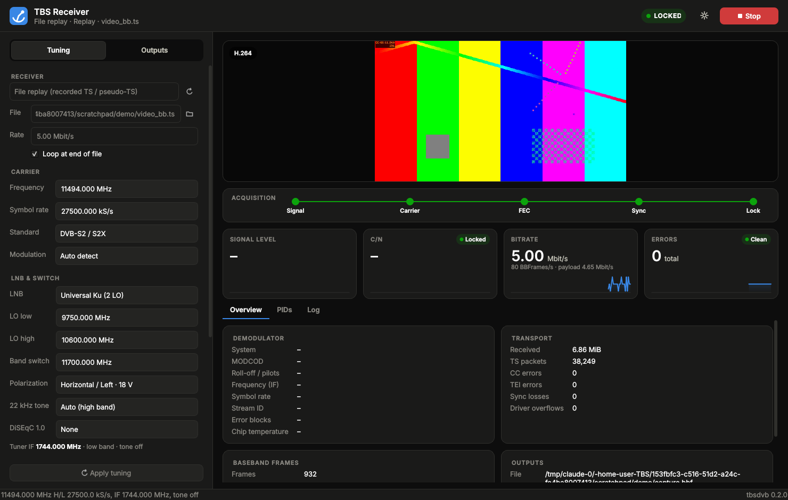
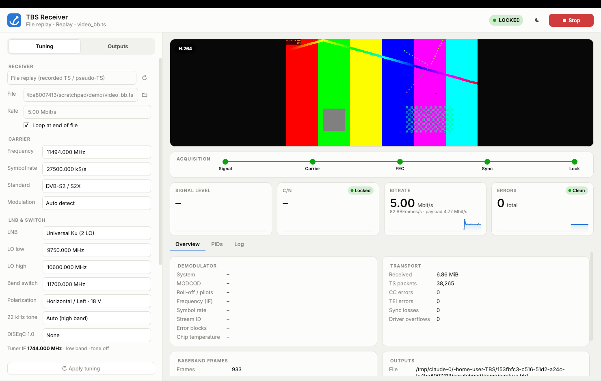

# TBS Receiver

Software for **TBS 6903x** (STiD135) DVB-S2/S2X receivers, in three parts:

| Part | What it is | Depends on |
|------|------------|------------|
| **`tbsdvb`** library (`libtbsdvb/`) | Tunes the card, reads status, captures TS or BBFrames, writes files, publishes over ZeroMQ. C++17 API plus a C API. | C++17 standard library; optionally libzmq. **No Qt.** |
| **`tbs-receiver`** (`app/`) | Desktop GUI built on the library. | Qt 6 (or 5.15); optionally FFmpeg for video. |
| **`tbs-cli`** (`tools/`) | Headless command-line front end. | the library only |

Supported backends:

| Backend | Platform | Notes |
|---------|----------|-------|
| Linux DVB API | Linux | TBS open-source driver `linux_media`. Full support, including BBFrames via `stid135 bbframe=1`. |
| Windows BDA | Windows | TBS BDA driver through DirectShow. Uses the TBS extensions for LNB power, tone, raw DiSEqC, DVB-S2 parameters and stream ID. |
| File replay | all | Replays recorded TS or pseudo-TS; for testing without hardware. |



<details><summary>Light theme</summary>



</details>

## Building

CMake ≥ 3.16 and a C++17 compiler are required. Everything else is optional and detected automatically:

| Option | Default | |
|--------|---------|---|
| `TBS_BUILD_GUI` | ON | Qt GUI (skipped with a warning if Qt is missing) |
| `TBS_BUILD_TOOLS` | ON | `tbs-cli`, `tbs-make-test-stream`, `tbs-c-example` |
| `TBS_BUILD_TESTS` | ON | `ctest` unit and end-to-end tests |
| `TBS_ENABLE_FFMPEG` | ON | Video preview in the GUI |
| `TBSDVB_ENABLE_ZMQ` | ON | ZeroMQ sink in the library |
| `TBSDVB_BUILD_SHARED` | OFF | Build `tbsdvb` as a shared library (DLL/.so) |

**Linux (Debian/Ubuntu)**
```sh
sudo apt install build-essential cmake pkg-config qt6-base-dev libzmq3-dev \
                 libavformat-dev libavcodec-dev libswscale-dev libavutil-dev
cmake -S . -B build -DCMAKE_BUILD_TYPE=Release
cmake --build build -j && ctest --test-dir build
./build/app/tbs-receiver
```
Install the TBS driver first ([tbsdtv/linux_media](https://github.com/tbsdtv/linux_media/wiki)). Your user needs
access to `/dev/dvb`, usually by joining the `video` group.

**Windows (MSVC + vcpkg)**
```bat
vcpkg install zeromq:x64-windows ffmpeg[avcodec,avformat,swscale]:x64-windows
cmake -S . -B build -DCMAKE_PREFIX_PATH=C:\Qt\6.7.2\msvc2019_64 ^
      -DCMAKE_TOOLCHAIN_FILE=%VCPKG_ROOT%\scripts\buildsystems\vcpkg.cmake
cmake --build build --config Release
C:\Qt\6.7.2\msvc2019_64\bin\windeployqt build\app\Release\tbs-receiver.exe
```
Install the TBS BDA driver for the card. The library and tools can also be cross-compiled from Linux:
`cmake -S . -B build-win -DCMAKE_TOOLCHAIN_FILE=cmake/toolchains/mingw-w64-x86_64.cmake -DTBS_BUILD_GUI=OFF -DTBSDVB_ENABLE_ZMQ=OFF`.

**macOS**: `brew install cmake qt zeromq ffmpeg pkg-config`, then configure with
`-DCMAKE_PREFIX_PATH="$(brew --prefix qt)"`. TBS has no macOS driver, so only file replay works on macOS.

## Troubleshooting: "Cannot open /dev/dvb/adapter0/frontend0"

Run the built-in check. It prints the cause and what to do:

```sh
./build/tbs-cli --diagnose --device linux:0:0
```
In the GUI, press **Diagnose** next to the receiver list. The checks also run automatically when opening a
frontend fails, and the results appear in the **Log** tab.

The same checks by hand, in order:

| Check | Command | Expected |
|-------|---------|----------|
| Card visible on PCI | `lspci -nnk \| grep -A3 544d` | `544d:6178`, `Kernel driver in use: tbsecp3` |
| Modules loaded | `lsmod \| grep -E "tbsecp3\|stid135\|dvb_core"` | all three |
| Driver built for this kernel | `modinfo tbsecp3 \| grep vermagic` vs `uname -r` | same version |
| Load errors | `sudo modprobe tbsecp3; sudo dmesg \| grep -iE "tbs\|stid135\|dvb"` | adapters registered |
| Device nodes | `ls -l /dev/dvb/adapter*/` | `frontend0`, `demux0`, `dvr0` |
| Permissions | `groups` | includes `video` |

Common causes:
- **Kernel updated after installing the driver.** Rebuild and reinstall the TBS media_build, then reboot.
- **Secure Boot is on.** `dmesg` shows "Key was rejected by service". Disable Secure Boot, or sign the modules.
- **The distribution's media modules are mixed with the TBS ones.** `dmesg` shows "Unknown symbol". Reinstall
  the TBS driver and reboot.
- **No permission.** Run `sudo usermod -aG video $USER`, then log out and back in.
- **Wrong numbers.** Each 6903x tuner is its own adapter, for example `adapter0/frontend0` and
  `adapter1/frontend0`. Other DVB cards shift the numbers, so use the list in the GUI or `tbs-cli --list`.

## Using the library

Link `TbsDvb::tbsdvb`. Either add the source tree with `add_subdirectory(libtbsdvb)`, or run `cmake --install`
and use `find_package(TbsDvb)`.

```cpp
#include <tbsdvb/tbsdvb.h>

tbs::ReceiverConfig cfg;
cfg.device.kind = tbs::DeviceKind::LinuxDvb;           // or WindowsBda / FileReplay
cfg.device.adapter = 0;
cfg.tuning.frequencyMHz = 11494;                         // RF; LNB settings convert it to the IF
cfg.tuning.symbolRateKsps = 27500;
cfg.tuning.polarization = tbs::Polarization::HorizontalLeft18V;
cfg.tuning.inputStreamId = 3;                            // multistream ISI, -1 = off
cfg.capture = tbs::CaptureMode::BBFrame;
cfg.zmq.enabled = true;                                  // optional built-in outputs
cfg.zmq.endpoint = "tcp://*:5555";

tbs::Receiver rx;
tbs::Receiver::Callbacks cb;                             // all optional; run on the capture thread
cb.onBbFrame = [](const uint8_t *frame, size_t len, const tbs::BbHeader &h) { /* ... */ };
cb.onTsPackets = [](const uint8_t *pkts, size_t count) { /* count x 188 bytes */ };
cb.onStatus = [](const tbs::FrontendStatus &st) { /* lock, dBm, C/N, BER, MODCOD ... */ };
cb.onLog = [](const std::string &msg) { /* ... */ };
rx.setCallbacks(cb);
rx.start(cfg);

rx.status();                  // latest FrontendStatus (thread safe)
rx.stats();                   // latest StreamStats
rx.retune(newTuning);         // retune without restarting the capture
rx.stop();
```

Other public pieces you can use on their own:
- `tbs::Devices::enumerate()` lists the receivers present.
- `ITunerDevice` gives low-level device access.
- `TsAnalyzer`, `BbFrameExtractor`, `BbFrameToTs` and `BbHeader` are parsers you can use without a device.
- `FileSink`, `ZmqSink`, or your own `IOutputSink` via `Receiver::addSink()`.

**C API** (`#include <tbsdvb/tbsdvb_c.h>`) for C, Python (ctypes), C# and others:
`tbs_config_init`, `tbs_enumerate_devices`, `tbs_receiver_create/start/stop/retune/get_status/get_stats`, and
log, state and data callbacks. See `tools/c_api_example.c`. Build with `-DTBSDVB_BUILD_SHARED=ON` to get a
DLL/.so for other languages.

## Using the GUI

* **Tuning**: receiver, frequency, symbol rate, standard, LNB (universal, single LO or direct L-band),
  polarization, 22 kHz tone, DiSEqC 1.0 port, input stream ID and PLS (root/gold), plus TS or BBFrame capture.
  The tuner IF is computed and checked live. While capturing, change the tuning and press **Apply tuning**
  to retune without stopping.
* **Outputs**:
  * a file: `.ts`, or BBFrames as raw, `0xB8`-prefixed, or the pseudo-TS as received;
  * ZeroMQ: PUB or PUSH, bind or connect, optional topic and metadata header;
  * the video preview, which can be switched on or off while running.
* **Status**:
  * header: lock pill;
  * acquisition chain: Signal → Carrier → FEC → Sync → Lock;
  * tiles with live sparklines (hover for values): signal level, C/N with a quality label, bitrate, and errors;
  * Overview: MODCOD, roll-off, stream ID, temperature, TS counters, decoded BBHeader, output status;
  * PIDs: per-PID share bars;
  * Log.
* Light/dark toggle in the header. **F5** starts and stops. `--autostart` starts at launch;
  `--theme light|dark` picks the theme.

## BBFrames

With BBFrame output on, the STiD135 wraps each BBFrame in private sections on PID **0x010E** (0x0118 with
the Windows driver):

```
first packet : 47 41 0E 1x 00 80 00 L B8 <10-byte BBHeader> <169 data bytes>
next packets : 47 41 0E 1x 00 80 00 L N  <179 data bytes>                  N = 1, 2, 3 ...
last packet  : 47 41 0E 1x 00 80 00 L N  <L-1 data bytes> <0xFF padding>
```
The library rebuilds the frames, checks the BBHeader CRC-8 in both normal (NM) and high-efficiency (HEM) mode,
checks the packet counters, and trims each frame to `10 + DFL/8` bytes.

On Linux, turn the mode on with `echo "options stid135 bbframe=1" | sudo tee /etc/modprobe.d/stid135.conf`
and reload the driver. The receiver warns if `bbframe=0`. Only Generic Stream / GSE carriers come out as
BBFrames; TS carriers stay TS.

## Windows BDA backend

DirectShow graph:

```
Network Provider → TBS tuner → [capture filter] → Infinite Tee ─┬─ Sample Grabber → Null Renderer   (data)
                                                                 └─ MPEG-2 Demux → TIF               (helps some providers tune)
```

Standard BDA carries frequency, symbol rate, polarization, LO/switch overrides and the DiSEqC port
(`IDVBSLocator2`). Signal statistics come from `IBDA_SignalStatistics`. When the TBS property set
`{FAA8F3E5-31D4-4e41-88EF-D9EB716F6EC9}` is present on the tuner input pin, it is used for:
- **#21**: LNB power, 22 kHz tone and raw DiSEqC;
- **#10**: DVB-S2 parameters;
- **#96**: stream ID (ISI/PLS).

The layouts of #21 and #10 match MediaPortal's open-source TBS support.

> **Status:** the Windows backend compiles and links with MinGW-w64. The library tests and the CLI pass under
> Wine, and the Windows build gives byte-identical output to the Linux build. It has **not yet been tested
> with a real TBS card on Windows**. In particular, the value format of the stream-ID property (#96) is not
> publicly documented. It is sent with the same packing as Linux (`isi | code<<8 | mode<<26`), so check ISI/PLS
> on a multistream carrier before relying on it. The BDA signal strength unit varies between drivers and is
> shown as dBm or %, depending on the range.

## ZeroMQ message format

One message per unit: *N* × 188-byte TS packets in TS mode (default *N* = 7), or one BBFrame.
```
[topic frame]  if a topic is set (multipart: topic first)
[header]       if enabled, 20 bytes little endian: "TBS1" | u8 type (0 TS, 1 BBFrame) | u8 flags | u16 reserved
               | u32 sequence | u64 timestamp (µs since epoch)
payload
```
`tools/zmq_receiver.py` is a sample client. **PUB** drops messages sent before a subscriber connects, and
drops for slow subscribers. **PUSH** queues up to the HWM. Use PUSH when every message matters.

## Testing without hardware

```sh
ffmpeg -f lavfi -i testsrc2=size=1280x720:rate=25 -t 20 -c:v libx264 -f mpegts video.ts
./build/tbs-make-test-stream --in video.ts --out video_bb.ts         # TS -> BBFrames -> card pseudo-TS
./build/tbs-cli --device replay:video_bb.ts --rate 5 --bbframe --out frames.bbf --zmq tcp://*:5555
```
In the GUI, choose *File replay*, select `video_bb.ts` and *BBFrames*, and the preview shows the video.

## Command line

```
tbs-cli --list
tbs-cli --device linux:0:0 --freq 11494 --sr 27500 --pol h --out capture.ts
tbs-cli --device bda:0 --freq 10971 --sr 29700 --pol h --isi 3 --bbframe --zmq tcp://*:5555 --push
```
Run `tbs-cli --help` for all options: LNB, tone, DiSEqC, PLS, file formats, ZeroMQ options and `--duration`.

## Source layout

```
libtbsdvb/include/tbsdvb/   public API (Receiver, Types, Status, Device, Sink, parsers, C API)
libtbsdvb/src/              implementation; platform/ holds LinuxDvbDevice and WinBdaDevice
app/                        Qt GUI (theme, widgets, panels, video)
tools/                      tbs-cli, tbs-make-test-stream, C API example, zmq_receiver.py
tests/                      unit tests and an end-to-end Receiver test
cmake/                      find modules, MinGW toolchain
```
