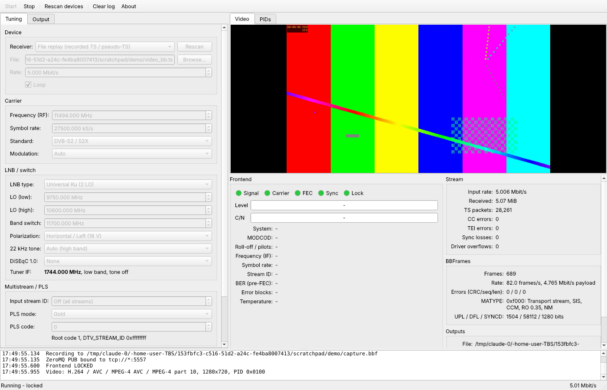

# TBS Receiver

A Qt/C++ desktop application for **TBS 6903x** (STiD135) DVB-S2/S2X receivers. It:

* tunes the card using settings you enter (frequency, symbol rate, LNB, polarization, 22 kHz tone,
  DiSEqC, input stream ID, PLS);
* captures either the **transport stream** or the **BBFrames** the card outputs;
* writes the data to a **file** and/or publishes it over **ZeroMQ** (PUB or PUSH);
* shows the **card status**: lock flags, signal level, C/N, BER, error blocks, chip temperature,
  detected MODCOD/roll-off/pilots, stream statistics, decoded BBHeader (MATYPE, ISI, DFL...) and a PID table;
* shows a **video preview** of the received service (FFmpeg).

Built with CMake; runs on Linux, Windows and macOS (see [Platform support](#platform-support)).



## How it works

```
 TBS 6903x ──► ITunerDevice ──► TsAnalyzer ──┬─────────────────────────────► FileSink / ZmqSink   (TS mode)
 (frontend,    LinuxDvbDevice   (188-byte    │
  demux)       FileReplayDevice  alignment,  └─► BbFrameExtractor ─┬───────► FileSink / ZmqSink   (BBFrame mode)
                                 CC/PID       (pseudo-TS → BBFrame,│
                                 stats)        CRC-8 check)        └─► BbFrameToTs ─┐
                                                                                    ├─► VideoDecoder ─► VideoWidget
                                     (TS mode) ─────────────────────────────────────┘    (FFmpeg)
```

`ReceiverEngine` runs this pipeline on a worker thread and sends the frontend status and statistics to the
UI twice a second.

### BBFrame capture on the TBS 6903x

The TBS Linux driver can make the STiD135 output BBFrames instead of TS. Each BBFrame is then carried in
private sections on PID **0x010E** (0x0118 with the Windows driver):

```
first packet : 47 41 0E 1x 00 80 00 L B8 <10-byte BBHeader> <169 data bytes>
next packets : 47 41 0E 1x 00 80 00 L N  <179 data bytes>                  N = 1, 2, 3 ...
last packet  : 47 41 0E 1x 00 80 00 L N  <L-1 data bytes> <0xFF padding>
```

`BbFrameExtractor` rebuilds each frame, checks the BBHeader CRC-8 (normal and high-efficiency mode), checks
packet counter continuity, and trims each frame to `10 + DFL/8` bytes.

To turn this mode on, load the driver with the `bbframe` option:

```sh
echo "options stid135 bbframe=1" | sudo tee /etc/modprobe.d/stid135.conf
# reboot, or reload the TBS modules
cat /sys/module/stid135/parameters/bbframe   # should print 1
```

The application reads this parameter and warns in the log when it is `0`. The driver only does this for
**Generic Stream / GSE** carriers (TS/GS ≠ 11). A carrier that carries a normal transport stream still
comes out as TS. The application warns when you choose BBFrame mode but no BBFrame PID shows up.

## Building

Requirements: CMake ≥ 3.16, a C++17 compiler, Qt 6 (or Qt 5.15) Widgets.
Optional: **libzmq** (ZeroMQ output), **FFmpeg** libavformat/libavcodec/libswscale/libavutil (video preview).
If an optional library is missing, CMake prints a warning and builds without that feature.

| CMake option        | Default | Meaning                    |
|---------------------|---------|----------------------------|
| `TBS_ENABLE_ZMQ`    | ON      | ZeroMQ output              |
| `TBS_ENABLE_FFMPEG` | ON      | Video preview              |
| `TBS_BUILD_TESTS`   | ON      | Unit tests (`ctest`)       |

### Linux (Debian/Ubuntu)

```sh
sudo apt install build-essential cmake pkg-config qt6-base-dev libzmq3-dev \
                 libavformat-dev libavcodec-dev libswscale-dev libavutil-dev
cmake -S . -B build -DCMAKE_BUILD_TYPE=Release
cmake --build build -j
ctest --test-dir build
./build/tbs-receiver
```

Install the TBS open-source driver first ([tbsdtv/linux_media](https://github.com/tbsdtv/linux_media/wiki)).
Your user needs access to `/dev/dvb` (usually by joining the `video` group).

### macOS

```sh
brew install cmake qt zeromq ffmpeg pkg-config
cmake -S . -B build -DCMAKE_PREFIX_PATH="$(brew --prefix qt)"
cmake --build build -j
```

### Windows (MSVC)

Install Qt (online installer or `aqtinstall`) and use vcpkg for the optional libraries:

```bat
vcpkg install zeromq:x64-windows ffmpeg[avcodec,avformat,swscale]:x64-windows
cmake -S . -B build -DCMAKE_PREFIX_PATH=C:\Qt\6.7.2\msvc2019_64 ^
      -DCMAKE_TOOLCHAIN_FILE=%VCPKG_ROOT%\scripts\buildsystems\vcpkg.cmake
cmake --build build --config Release
C:\Qt\6.7.2\msvc2019_64\bin\windeployqt build\Release\tbs-receiver.exe
```

If you have a prebuilt FFmpeg (for example a "full_build-shared" package) instead of vcpkg, pass
`-DFFMPEG_ROOT=C:\path\to\ffmpeg`.

## Using the application

**Tuning tab**

* **Receiver**: DVB frontends found under `/dev/dvb` (on a TBS 6903x, one per tuner), a manual
  adapter/frontend entry, or **File replay**.
* **Frequency (RF)** with the **LNB** settings. The IF sent to the card is shown, and must fall within
  950–2150 MHz. Use *None (L-band input)* when you enter the IF directly.
* **Polarization** sets the LNB voltage (13 V / 18 V). **22 kHz tone** *Auto* switches it on in the high
  band. **DiSEqC 1.0** sends a committed switch command, followed by a tone burst.
* **Input stream ID** selects one stream of a multistream carrier. **PLS mode/code** sets the
  physical-layer scrambling. Both are packed into `DTV_STREAM_ID` the way the TBS driver expects
  (`isi | code << 8 | mode << 26`). With no ISI filter, the gold code goes in `DTV_SCRAMBLING_SEQUENCE_INDEX`.
* **Output data**: *Transport stream* or *BBFrames*.

**Output tab**

* **Write to file**: TS mode writes `.ts`. BBFrame mode can write:
  * *Raw*: BBHeader + data field, one frame after another;
  * *0xB8 + BBFrame*: the format used by [bbframe-tools](https://github.com/newspaperman/bbframe-tools)
    (`bbfedi2eti`, `bbfudpdecap`...);
  * *Pseudo-TS*: the 188-byte packets exactly as the card sent them.
* **Send over ZeroMQ**: endpoint (for example `tcp://*:5555`), PUB or PUSH, bind or connect.
  Optional topic frame and an optional metadata header (see below).
* **Decode and show video**: decodes the first video stream with FFmpeg. Video only, no audio.

Press **Start** (F5) to tune and capture, and **Stop** to end. Settings are saved between runs.
`tbs-receiver --autostart` starts capturing at launch with the last used settings.

### ZeroMQ message format

Each message is one unit: *N* × 188-byte TS packets in TS mode (*N* = "TS packets / msg", default 7),
or one complete BBFrame in BBFrame mode.

```
[topic frame]   only if a topic is set (multipart message, topic first)
[header]        only if "metadata header" is on — 20 bytes, little endian:
                  char[4] "TBS1" | u8 type (0 = TS, 1 = BBFrame) | u8 flags | u16 reserved
                  u32 sequence | u64 timestamp (microseconds since epoch)
payload
```

`tools/zmq_receiver.py` is a sample client (`pip install pyzmq`). Note how the two socket types differ:
**PUB** drops any messages sent before a subscriber has connected, and drops messages once a slow
subscriber reaches the high-water mark. **PUSH** blocks delivery until a PULL peer connects, and queues up
to the HWM. Use PUSH when every message matters. The application never blocks the capture: anything it
cannot queue is counted as *dropped*.

## Testing without hardware

`tbs-make-test-stream` wraps any transport stream into DVB-S2 BBFrames and writes the pseudo-TS format the
card produces. You can then replay it in **BBFrame** mode, preview video included:

```sh
ffmpeg -f lavfi -i testsrc2=size=1280x720:rate=25 -t 20 -c:v libx264 -f mpegts video.ts
./build/tbs-make-test-stream --in video.ts --out video_bb.ts          # normal mode
./build/tbs-make-test-stream --in video.ts --out video_hem.ts --hem   # high efficiency mode
```

Then choose *File replay* with `video_bb.ts`, set a rate (for example 5 Mbit/s), and pick *BBFrames*.

## Platform support

| Platform | UI, file/ZMQ output, preview, replay | Direct card control |
|----------|--------------------------------------|---------------------|
| Linux    | yes | yes: Linux DVB API with the TBS `linux_media` driver |
| Windows  | yes | not yet: the TBS card needs a BDA/DirectShow backend |
| macOS    | yes | no: TBS has no macOS driver for PCIe cards |

The device layer sits behind the small `ITunerDevice` interface (`src/core/ITunerDevice.h`). A Windows BDA
backend (TBS publishes its BDA extension property sets in its SDK) can be added without touching the
pipeline or the UI.

## Source layout

```
src/core/     tuning config, devices (Linux DVB, file replay), TS/BBFrame parsing, ReceiverEngine
src/output/   FileSink, ZmqSink
src/video/    FFmpeg decoder, video widget
src/ui/       main window, tuning/output/status panels
tests/        unit tests and stream builders
tools/        tbs-make-test-stream, zmq_receiver.py
```
