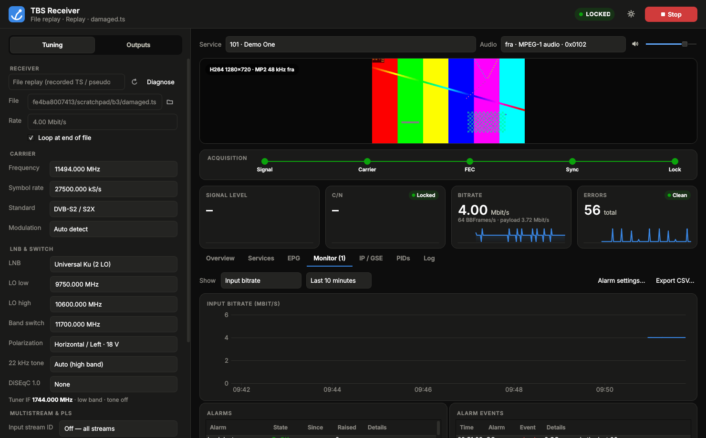
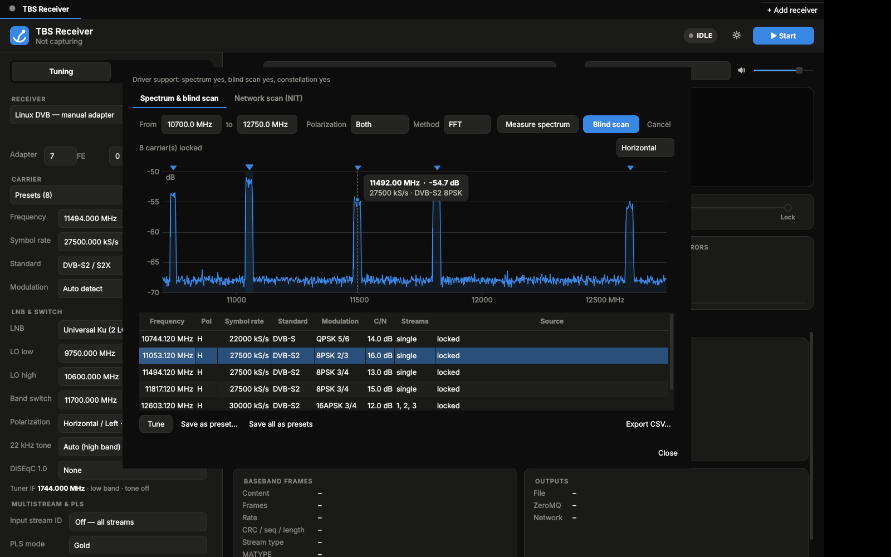
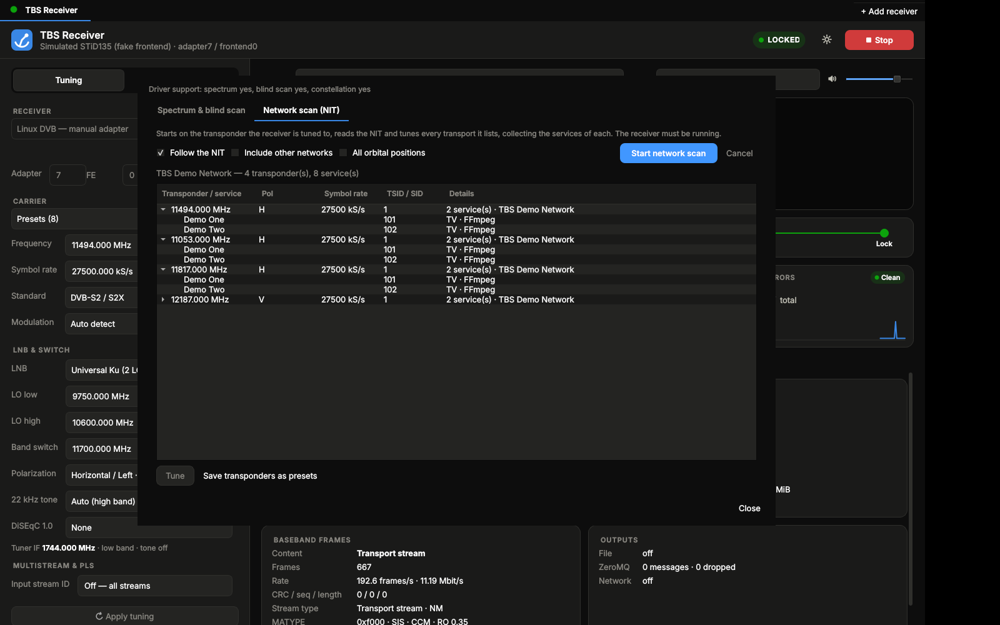
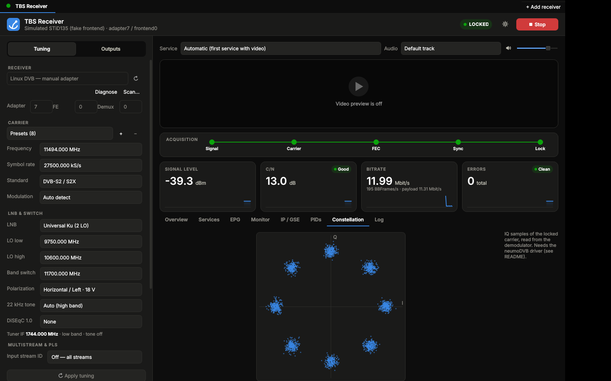
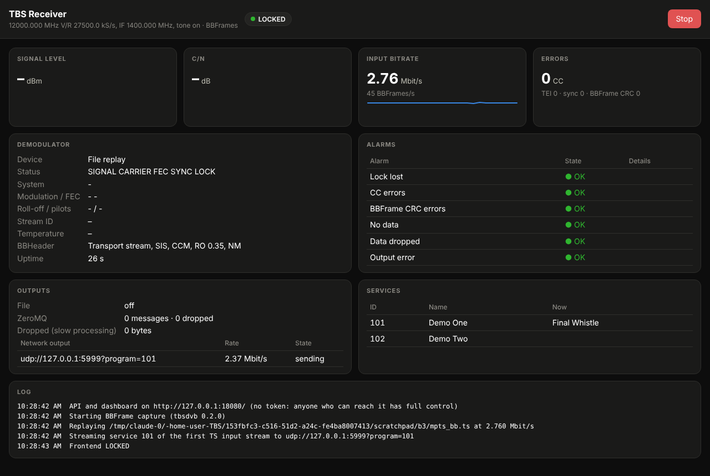
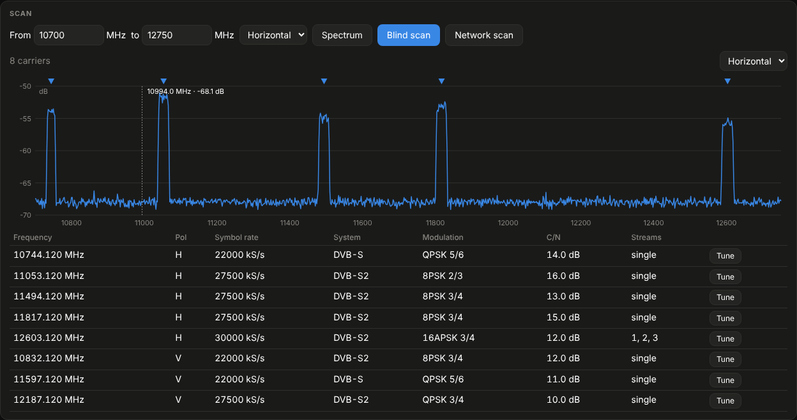
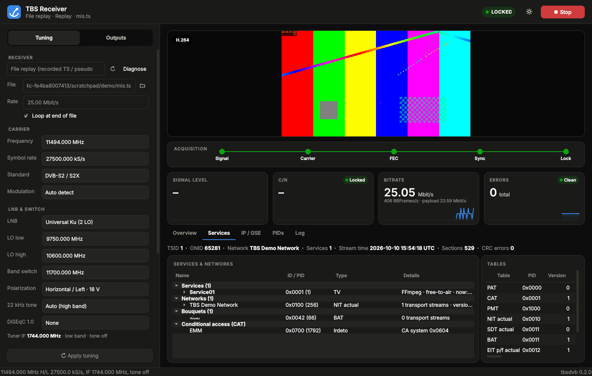
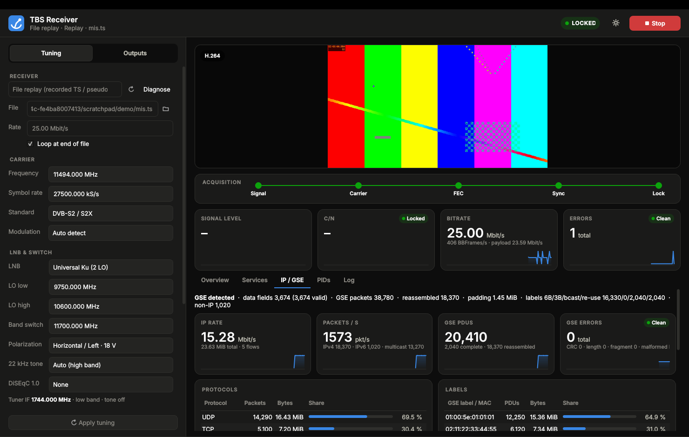
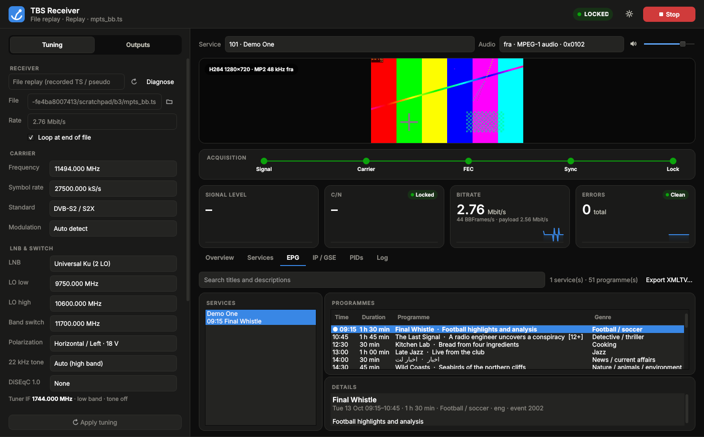

# TBS Receiver

Software for **TBS 6903x** (STiD135) DVB-S2/S2X receivers, in five parts:

| Part | What it is | Depends on |
|------|------------|------------|
| **`tbsdvb`** library (`libtbsdvb/`) | Tunes the card, reads status, captures TS or BBFrames, writes files, publishes over ZeroMQ, streams TS (or single services) over UDP/RTP/SRT, monitors the receiver with alarms. Spectrum, blind scan and constellation (IQ) with the neumoDVB driver. C++17 API plus a C API. | C++17 standard library; optionally libzmq and libsrt. **No Qt.** |
| **`tbsbbproc`** library (`libbbproc/`) | Processes BBFrames: detects TS or Generic Stream per ISI, including non-standard encapsulations (GSE dialects, TS or raw IP inside a generic stream). Analyses PSI/SI tables of TS streams. Decapsulates GSE and MPE, writes IP to pcap/pcapng or a TUN/TAP interface, keeps IP statistics. Scans a network transponder by transponder from its NIT. | `tbsdvb`; C++17 only. **No Qt, no hardware.** |
| **`tbs-receiver`** (`app/`) | Desktop GUI built on the library. | Qt 6 (or 5.15); optionally FFmpeg for video. |
| **`tbs-daemon`** (`daemon/`) | Headless receiver for servers: JSON config, REST + WebSocket API, web dashboard, systemd unit. | the libraries only |
| **`tbs-cli`**, **`tbs-bbproc`** (`tools/`) | Command-line capture front end, and offline capture-file analysis. | the libraries only |

Supported backends:

| Backend | Platform | Notes |
|---------|----------|-------|
| Linux DVB API | Linux | TBS open-source driver `linux_media`. Full support, including BBFrames via `stid135 bbframe=1`. Spectrum, blind scan and constellation need the [neumoDVB driver](#spectrum-blind-scan-and-network-scan) instead. |
| Windows BDA | Windows | TBS BDA driver through DirectShow. Uses the TBS extensions for LNB power, tone, raw DiSEqC, DVB-S2 parameters and stream ID. |
| File replay | all | Replays recorded TS or pseudo-TS; for testing without hardware. |


<details><summary>Light theme</summary>


</details>

## Installing

Installers are built by CI (the `package-*` jobs; attached to the GitHub release for `v*` tags):

| Platform | Package | Contents |
|---|---|---|
| Debian / Ubuntu | `tbs-receiver_<version>_amd64.deb` (`sudo apt install ./tbs-receiver_*.deb`) | GUI with desktop entry, `tbs-daemon` (+ systemd unit and example config in `/usr/share/tbs-receiver`), command-line tools, libraries and headers, Python module |
| Any Linux | `TBS_Receiver-<version>-x86_64.AppImage` | GUI and tools with Qt, FFmpeg, ZeroMQ and SRT bundled; `chmod +x` and run |
| Windows | `tbs-receiver-<version>-win64.exe` (NSIS) or `.zip` | GUI with Qt and FFmpeg, tools, daemon; Start menu entry, optional PATH entry, uninstaller |
| macOS | `tbs-receiver-<version>-Darwin.dmg` | TBS Receiver.app and the tools (file replay and analysis only: TBS has no macOS driver) |

Building them yourself:
```sh
cmake -S . -B build -DCMAKE_BUILD_TYPE=Release && cmake --build build -j
cd build && cpack -G DEB                 # Linux: also TGZ; Windows: NSIS/ZIP; macOS: DragNDrop
packaging/appimage/build-appimage.sh     # downloads linuxdeploy + its Qt plugin
```

## Building

CMake ≥ 3.16 and a C++17 compiler are required. Everything else is optional and detected automatically:

| Option | Default | |
|--------|---------|---|
| `TBS_BUILD_GUI` | ON | Qt GUI (skipped with a warning if Qt is missing) |
| `TBS_BUILD_TOOLS` | ON | `tbs-cli`, `tbs-make-test-stream`, `tbs-c-example` |
| `TBS_BUILD_TESTS` | ON | `ctest` unit and end-to-end tests |
| `TBS_BUILD_DAEMON` | ON | `tbs-daemon` |
| `TBS_BUILD_PYTHON` | ON | Python module `tbsdvb` (needs pybind11 and the Python development files) |
| `TBS_ENABLE_FFMPEG` | ON | Video preview in the GUI; with Qt 6 Multimedia and libswresample also audio |
| `TBSDVB_ENABLE_ZMQ` | ON | ZeroMQ sink in the library |
| `TBSDVB_ENABLE_SRT` | ON | SRT network output (UDP and RTP need nothing extra) |
| `TBSDVB_BUILD_SHARED` | OFF | Build `tbsdvb` as a shared library (DLL/.so) |

**Linux (Debian/Ubuntu)**
```sh
sudo apt install build-essential cmake pkg-config qt6-base-dev libzmq3-dev \
                 libavformat-dev libavcodec-dev libswscale-dev libavutil-dev libswresample-dev \
                 qt6-multimedia-dev libsrt-gnutls-dev pybind11-dev python3-dev
cmake -S . -B build -DCMAKE_BUILD_TYPE=Release
cmake --build build -j && ctest --test-dir build
./build/app/tbs-receiver
```
Install the TBS driver first ([tbsdtv/linux_media](https://github.com/tbsdtv/linux_media/wiki)). Your user needs
access to `/dev/dvb`, usually by joining the `video` group.

**Windows (MSVC + vcpkg)**
```bat
vcpkg install zeromq:x64-windows ffmpeg[avcodec,avformat,swscale]:x64-windows   # add libsrt:x64-windows for SRT
cmake -S . -B build -DCMAKE_PREFIX_PATH=C:\Qt\6.7.2\msvc2019_64 ^
      -DCMAKE_TOOLCHAIN_FILE=%VCPKG_ROOT%\scripts\buildsystems\vcpkg.cmake
cmake --build build --config Release
C:\Qt\6.7.2\msvc2019_64\bin\windeployqt build\app\Release\tbs-receiver.exe
```
Install the TBS BDA driver for the card. The library and tools can also be cross-compiled from Linux:
`cmake -S . -B build-win -DCMAKE_TOOLCHAIN_FILE=cmake/toolchains/mingw-w64-x86_64.cmake -DTBS_BUILD_GUI=OFF -DTBSDVB_ENABLE_ZMQ=OFF`.

**macOS**: `brew install cmake qt zeromq ffmpeg srt pkg-config`, then configure with
`-DCMAKE_PREFIX_PATH="$(brew --prefix qt)"`. TBS has no macOS driver, so only file replay works on macOS.

## Troubleshooting: "Cannot open /dev/dvb/adapter0/frontend0"

Run the built-in check. It prints the cause and what to do:

```sh
./build/tbs-cli --diagnose --device linux:0:0
```
In the GUI, press **Diagnose** next to the receiver list. The checks also run automatically when opening a
frontend fails, and the results appear in the **Log** tab.

The same checks by hand, in order:

| Check | Command | Expected |
|-------|---------|----------|
| Card visible on PCI | `lspci -nnk \| grep -A3 544d` | `544d:6178`, `Kernel driver in use: tbsecp3` |
| Modules loaded | `lsmod \| grep -E "tbsecp3\|stid135\|dvb_core"` | all three |
| Driver built for this kernel | `modinfo tbsecp3 \| grep vermagic` vs `uname -r` | same version |
| Load errors | `sudo modprobe tbsecp3; sudo dmesg \| grep -iE "tbs\|stid135\|dvb"` | adapters registered |
| Device nodes | `ls -l /dev/dvb/adapter*/` | `frontend0`, `demux0`, `dvr0` |
| Permissions | `groups` | includes `video` |

Common causes:
- **Kernel updated after installing the driver.** Rebuild and reinstall the TBS media_build, then reboot.
- **Secure Boot is on.** `dmesg` shows "Key was rejected by service". Disable Secure Boot, or sign the modules.
- **The distribution's media modules are mixed with the TBS ones.** `dmesg` shows "Unknown symbol". Reinstall
  the TBS driver and reboot.
- **No permission.** Run `sudo usermod -aG video $USER`, then log out and back in.
- **Wrong numbers.** Each 6903x tuner is its own adapter, for example `adapter0/frontend0` and
  `adapter1/frontend0`. Other DVB cards shift the numbers, so use the list in the GUI or `tbs-cli --list`.

## Using the library

Link `TbsDvb::tbsdvb`. Either add the source tree with `add_subdirectory(libtbsdvb)`, or run `cmake --install`
and use `find_package(TbsDvb)`.

```cpp
#include <tbsdvb/tbsdvb.h>

tbs::ReceiverConfig cfg;
cfg.device.kind = tbs::DeviceKind::LinuxDvb;           // or WindowsBda / FileReplay
cfg.device.adapter = 0;
cfg.tuning.frequencyMHz = 11494;                         // RF; LNB settings convert it to the IF
cfg.tuning.symbolRateKsps = 27500;
cfg.tuning.polarization = tbs::Polarization::HorizontalLeft18V;
cfg.tuning.inputStreamId = 3;                            // multistream ISI, -1 = off
cfg.capture = tbs::CaptureMode::BBFrame;
cfg.zmq.enabled = true;                                  // optional built-in outputs
cfg.zmq.endpoint = "tcp://*:5555";
tbs::TsNetworkOutput net;                                // stream one service as RTP multicast
tbs::parseNetworkUrl("rtp://239.1.1.1:5004?program=101&isi=3", &net);
cfg.network.push_back(net);

tbs::Receiver rx;
tbs::Receiver::Callbacks cb;                             // all optional; run on the capture thread
cb.onBbFrame = [](const uint8_t *frame, size_t len, const tbs::BbHeader &h) { /* ... */ };
cb.onTsPackets = [](const uint8_t *pkts, size_t count) { /* count x 188 bytes */ };
cb.onStatus = [](const tbs::FrontendStatus &st) { /* lock, dBm, C/N, BER, MODCOD ... */ };
cb.onLog = [](const std::string &msg) { /* ... */ };
rx.setCallbacks(cb);
rx.start(cfg);

rx.status();                  // latest FrontendStatus (thread safe)
rx.stats();                   // latest StreamStats
rx.retune(newTuning);         // retune without restarting the capture
rx.stop();
```

Other public pieces you can use on their own:
- `tbs::Devices::enumerate()` lists the receivers present.
- `ITunerDevice` gives low-level device access.
- `TsAnalyzer`, `BbFrameExtractor`, `BbFrameToTs` and `BbHeader` are parsers you can use without a device.
- `TsFilter` cuts one service (SPTS with a rewritten PAT) or a PID list out of a transport stream.
- `Monitor` keeps the receiver history and raises alarms (see [Monitoring and alarms](#monitoring-and-alarms)).
- `Scan::spectrum`, `Scan::blindScan`, `Receiver::constellation` and `bb::runNetworkScan` (see
  [Spectrum, blind scan and network scan](#spectrum-blind-scan-and-network-scan)).
- `FileSink`, `ZmqSink`, `TsNetworkSink`, or your own `IOutputSink` via `Receiver::addSink()`.

**Python** (`import tbsdvb`, built when pybind11 is found; installed into `dist-packages`):
```python
import tbsdvb
cfg = tbsdvb.ReceiverConfig()
cfg.device.adapter = 0
cfg.tuning.frequency_mhz, cfg.tuning.symbol_rate_ksps = 11494, 27500
cfg.capture = tbsdvb.CaptureMode.BBFrame
cfg.network.append(tbsdvb.TsNetworkOutput("udp://239.1.1.1:1234?program=101"))
rx, proc, mon = tbsdvb.Receiver(), tbsdvb.Processor(), tbsdvb.Monitor()
proc.open()
rx.attach_processor(proc)                      # analysis in C++, no Python per packet
rx.attach_monitor(mon)
rx.on_bbframe = lambda frame, header: ...      # optional: raw data in Python (bytes, BbHeader)
mon.set_alarm_callback(lambda e: print(e.type, e.raised, e.message))
rx.start(cfg)
...
print(rx.status().cnr_db, proc.snapshot()["streams"][0]["ts"]["services"])
open("epg.xml", "w").write(proc.xmltv())
fmt, snapshot, xmltv = tbsdvb.analyze_capture("recording.ts")   # offline
scan = tbsdvb.network_scan(rx, proc, [cfg.tuning])            # NIT scan on the running receiver
carriers = tbsdvb.blind_scan(cfg.device, 10700, 12750, cfg.tuning)  # neumoDVB driver, receiver stopped
```
Callbacks run on the capture threads with the GIL held; an exception in one is reported and the capture
continues. `python/example.py` is a complete script.

**Threads.** The receiver uses two threads, joined by a bounded buffer (128 MiB by default; set it
with `setPipelineBufferSize`).
- **Capture thread:** owns the device (reads, retunes, `onStatus`).
- **Processing thread:** does the parsing, the sinks, the data callbacks and `onStats`.

A slow disk or network output therefore never stalls the device. If processing falls behind for longer than
the buffer covers, data is dropped and counted (`StreamStats::pipelineDroppedBytes`), not lost silently. Callbacks
can run on either thread.

**C API** (`#include <tbsdvb/tbsdvb_c.h>`) for C, Python (ctypes), C# and others:
`tbs_config_init`, `tbs_enumerate_devices`, `tbs_receiver_create/start/stop/retune/get_status/get_stats`, and
log, state and data callbacks. Network outputs go in `tbs_config.network_urls` (up to four URLs; check one with
`tbs_check_network_url`). See `tools/c_api_example.c`. Build with `-DTBSDVB_BUILD_SHARED=ON` to get a
DLL/.so for other languages.

## Using the GUI

* **Several receivers at once**: **+ Add receiver** opens another tuner in its own tab. For example, the second
  tuner of a TBS 6903x defaults to the next adapter. Each tab has its own:
  * settings, outputs and preview;
  * EPG, monitor and alarms.

  The tab dot shows the state: locked, searching or stopped. Double-click a tab to rename it, and use
  Ctrl+Tab to switch. Only the receiver on screen is heard. `--autostart` starts them all.
* **Tuning**: receiver, frequency, symbol rate, standard, LNB (universal, single LO or direct L-band),
  polarization, 22 kHz tone, DiSEqC 1.0 port, input stream ID and PLS (root/gold), plus TS or BBFrame capture.
  The tuner IF is computed and checked live. While capturing, change the tuning and press **Apply tuning**
  to retune without stopping.
* **Presets**: the list above the carrier fields holds saved carriers (frequency, symbol rate, standard,
  polarization, DiSEqC port, ISI, PLS), shared by all receivers. **+** saves the current carrier, **−** deletes
  the selected one. The scan dialog can save everything it found as presets.
* **Scan…** (next to Diagnose) opens the spectrum, blind scan and network scan dialog (see
  [below](#spectrum-blind-scan-and-network-scan)).
* **Outputs**:
  * a file: `.ts`, or BBFrames as raw, `0xB8`-prefixed, or the pseudo-TS as received. Recording management:
    * a new file every N MiB and/or N minutes (`name_001.ts`, `name_002.ts`, ...); BBFrame segments start on a
      frame boundary;
    * **Keep newest N** for a rolling recording;
    * a clean stop when free disk space drops below a limit (default 500 MiB) or on a write error.

    The Overview shows the current segment, the free space and the processing-buffer level.
  * ZeroMQ: PUB or PUSH, bind or connect, optional topic and metadata header;
  * **Stream TS to network**: any number of UDP, RTP or SRT outputs, each sending the whole TS, a PID list or
    one service picked from the live service list (see below). Each row shows its rate and state while running;
  * the video preview, which can be switched on or off while running.
* **Preview**, above the video:
  * **Service:** pick a service, or leave it on automatic (the first service with video). In BBFrame mode
    this also selects the input stream (ISI) that is rebuilt. Double-clicking a service in the Services or
    EPG tab selects it too, and double-clicking an audio stream in the Services tab selects that track.
  * **Audio:** the default track, a track by language and codec, or off. Changing the track does not
    interrupt the picture. Radio services (audio only) play too.
  * **Volume and mute.** Audio needs Qt 6 Multimedia; video frames are timed against the audio clock for
    lip sync.
* **Status**:
  * header: lock pill;
  * acquisition chain: Signal → Carrier → FEC → Sync → Lock;
  * tiles with live sparklines (hover for values): signal level, C/N with a quality label, bitrate, and errors;
  * Overview: MODCOD, roll-off, stream ID, temperature, TS counters, decoded BBHeader, output status;
  * EPG: services, their programmes by day with the running one highlighted, details (extended text,
    genre, age rating), search, and **Export XMLTV…**;
  * Monitor: history chart, alarms and alarm events, alarm settings, CSV export (see below);
  * PIDs: per-PID share bars;
  * Constellation: IQ scatter plot of the locked carrier (neumoDVB driver);
  * Log.
* Light/dark toggle in the header. **F5** starts and stops. `--autostart` starts at launch;
  `--theme light|dark` picks the theme; `--tab NAME` and `--sidebar tuning|outputs` pick the open pages;
  `--scan` opens the scan dialog.

## Monitoring and alarms

`tbs::Monitor` (library) is fed from `Receiver::Callbacks::onStats`. It keeps one sample per stats interval for
24 hours. Each sample holds lock, level, C/N, BER, input and payload bitrate, CC/TEI/sync/BBFrame-CRC errors,
driver overflows, dropped data and output errors.

It evaluates these alarms:

| Alarm | Raised when | Default |
|---|---|---|
| Lock lost | no lock for *N* s | on, 3 s |
| Low C/N, low level | below a limit for *N* s | off |
| Low bitrate, no data | input below a limit / zero for *N* s | low bitrate off; no data on, 5 s |
| CC errors, BBFrame CRC errors | more than *N* in the error window (60 s) | on, 0 |
| Data dropped | driver overflows or processing too slow | on |
| Output error | recording stopped, network send errors | on |

**Acting on alarms.** Every change (raised or cleared) goes to a callback, to the event list, and optionally to a
**command**, which can send mail, call a webhook with curl, or switch to a backup feed. Placeholders are shell
quoted:
```
notify-send "TBS {alarm}" "{state}: {message}"
curl -s -X POST -d "{alarm} {state} {message} {time}" https://hooks.example/tbs
```

**In the GUI**, the **Monitor** tab shows:
- a history chart: C/N, level, input or payload bitrate, or error counts, over 10 min to 24 h, with lock-lost
  periods shaded and a hover readout;
- the alarm table and the alarm events;
- **Alarm settings…** and **Export CSV…**.

Alarms also go to the log, and the tab title counts the active ones.



## Spectrum, blind scan and network scan

**Network scan (NIT)** works with every driver and with file replay. Start the receiver on one transponder of
the network. The scan then:
1. reads the NIT (network information table);
2. tunes every transport it lists at the same orbital position (optionally also other networks and other
   positions);
3. collects the services of each transport from its SDT.

The result can be tuned directly or saved as presets. In the library it is `tbs::bb::runNetworkScan()`, which
works on a running `Receiver` that feeds a `Processor`. The satellite delivery descriptors are available as
structured fields (`TransportInfo::sat`), and `tuningFromNetwork()` turns a NIT into tuning parameters.

**Spectrum, blind scan and constellation** need driver support that the stock TBS driver does not have. They
use the frontend API extensions of **neumoDVB** (`DTV_SPECTRUM`, `DTV_SCAN`, `DTV_CONSTELLATION`). These come
with the `deepthought` branch of [deeptho/linux_media](https://github.com/deeptho/linux_media), which drives the
STiD135 of the TBS 6903x. Support is detected at run time: `tbs-cli --caps`, the scan dialog and
`GET /api/v1/scan/capabilities` say what the installed driver can do. With the stock driver these features
report "not supported", and everything else keeps working.

- **Spectrum:** the RF level across a range, per polarization, by FFT or sweep. A universal LNB range across
  11.7 GHz is measured as two bands, low then high with 22 kHz. Carrier candidates come from the driver, or
  else from a peak search on the spectrum.
- **Blind scan:** the driver searches the range and locks each carrier. Each one is reported with its
  frequency, symbol rate, standard, modulation, FEC, C/N and the input streams of a multistream carrier, ready
  to tune.
- **Constellation:** IQ samples of the locked carrier. They are shown live in the GUI's Constellation tab, read
  with `Receiver::setConstellationSamples()` and `constellation()`, and served by `GET /api/v1/constellation`.

The tuner can do one thing at a time. A spectrum or blind scan therefore needs the receiver stopped; the GUI
offers to stop it. A network scan uses the running receiver and retunes it to the start transponder at the end.



<details><summary>Network scan and constellation</summary>





</details>

## Headless daemon (`tbs-daemon`)

Runs the receiver, the content processing (tables, EPG, GSE/MPE, IP outputs), all outputs, and the monitor, with
no GUI, and serves an API and a web dashboard.

```sh
tbs-daemon --print-config > tbs-daemon.json     # defaults; edit device, tuning, outputs, alarms
tbs-daemon --config tbs-daemon.json             # missing file: created with the defaults
tbs-daemon --config tbs-daemon.json --listen 0.0.0.0:8080 --token "$(openssl rand -hex 16)"
```

- **Config:** the JSON file holds `receiver` (device, tuning, capture, file, zmq, network outputs as URLs),
  `processing` (pcap, TUN/TAP), `monitor` (alarm thresholds and command), `api` (listen address, token),
  `autostart` and `restartDelaySec`. `packaging/tbs-daemon.json` is an example.
- **Several tuners:** run one daemon per tuner, each with its own config file and port.
- **Restarts:** when the receiver stops with an error (device gone, driver reloaded), it is restarted after
  `restartDelaySec`.
- **Service:** `packaging/tbs-daemon.service` is a systemd unit. It runs as a `tbs` user in the `video` group,
  with `CAP_NET_ADMIN` only for TUN/TAP.

**API.** All endpoints are under `/api/v1/`. JSON, unless noted. With a token, send `Authorization: Bearer
TOKEN`, or `?token=` for the WebSocket.

| Method | Path | |
|---|---|---|
| GET | `status` | state, demodulator (lock, level, C/N, BER, MODCOD), stream counters, outputs, active alarms |
| GET / PUT | `config` | whole configuration; PUT may be partial, is validated, saved to the file, and restarts a running receiver |
| POST | `start`, `stop`, `restart` | receiver control |
| POST | `tune` | retune without restarting, e.g. `{"frequencyMHz": 11494, "polarization": "h"}` (saved) |
| GET | `devices` | receivers on this machine |
| GET | `streams` | per input stream: content, rate, services, EPG and IP counts |
| GET | `services?isi=N` | services with components, CA, now/next |
| GET | `epg?isi=N&service=ID`, `epg.xml` | EPG as JSON, or all of it as XMLTV |
| GET | `ip?isi=N` | IP statistics (GSE/MPE): protocols, top flows |
| GET | `alarms`, `history?seconds=N`, `history.csv?seconds=N`, `log?lines=N` | monitoring |
| POST | `scan/spectrum`, `scan/blind` | `{"start": 10700, "end": 12750, "polarization": "h"\|"v"\|"both"}`, plus optional `method`, `resolution`, `fftSize`, `maxSymbolRate` and `tuning` (LNB). Needs the receiver stopped. Answers `202`; one scan at a time |
| POST | `scan/network` | NIT scan on the running receiver; optional `followNit`, `nitOther`, `allPositions`, `lockTimeoutMs`, `tableTimeoutMs` |
| GET / POST | `scan`, `scan/cancel` | progress and the result of the last scan (spectra, carriers or transponders with services, each with a `tuning` for `tune`) |
| GET | `scan/capabilities`, `constellation?samples=N` | driver support; IQ samples of the locked carrier |
| WS | `ws` | pushes `status` once a second, plus `alarm`, `log`, `state` and `scan` (progress, each carrier or transponder found) messages |

```sh
curl -s -H "Authorization: Bearer $T" localhost:8080/api/v1/status | jq .frontend
curl -s -H "Authorization: Bearer $T" -X POST -d '{"frequencyMHz": 12188, "symbolRateKsps": 27500}' localhost:8080/api/v1/tune
curl -s -H "Authorization: Bearer $T" -X PUT -d '{"receiver": {"network": ["udp://239.1.1.1:1234?program=101"]}}' localhost:8080/api/v1/config
```

**Dashboard.** `http://host:8080/` shows lock, level, C/N, bitrate and errors with sparklines, the demodulator,
alarms, outputs, services and the live log, with start/stop. Its Scan card runs the spectrum, blind and network
scans, draws the spectrum, and tunes a result with one click. It follows the system light/dark setting and works
on a phone.

**Security.** The server is plain HTTP, meant for a trusted network. Set a token, and put it behind a reverse
proxy with TLS if it must be reachable from elsewhere.



<details><summary>Dashboard scan card</summary>



</details>

## BBFrames

With BBFrame output on, the STiD135 wraps each BBFrame in private sections on PID **0x010E** (0x0118 with
the Windows driver):

```
first packet : 47 41 0E 1x 00 80 00 L B8 <10-byte BBHeader> <169 data bytes>
next packets : 47 41 0E 1x 00 80 00 L N  <179 data bytes>                  N = 1, 2, 3 ...
last packet  : 47 41 0E 1x 00 80 00 L N  <L-1 data bytes> <0xFF padding>
```
The library rebuilds the frames, checks the BBHeader CRC-8 in both normal (NM) and high-efficiency (HEM) mode,
checks the packet counters, and trims each frame to `10 + DFL/8` bytes.

On Linux, turn the mode on with `echo "options stid135 bbframe=1" | sudo tee /etc/modprobe.d/stid135.conf`
and reload the driver. The receiver warns if `bbframe=0`. Only Generic Stream / GSE carriers come out as
BBFrames; TS carriers stay TS.

## Windows BDA backend

DirectShow graph:

```
Network Provider → TBS tuner → [capture filter] → Infinite Tee ─┬─ Sample Grabber → Null Renderer   (data)
                                                                 └─ MPEG-2 Demux → TIF               (helps some providers tune)
```

Standard BDA carries frequency, symbol rate, polarization, LO/switch overrides and the DiSEqC port
(`IDVBSLocator2`). Signal statistics come from `IBDA_SignalStatistics`. When the TBS property set
`{FAA8F3E5-31D4-4e41-88EF-D9EB716F6EC9}` is present on the tuner input pin, it is used for:
- **#21**: LNB power, 22 kHz tone and raw DiSEqC;
- **#10**: DVB-S2 parameters;
- **#96**: stream ID (ISI/PLS).

The layouts of #21 and #10 match MediaPortal's open-source TBS support.

> **Status:** the Windows backend compiles and links with MinGW-w64. The library tests and the CLI pass under
> Wine, and the Windows build gives byte-identical output to the Linux build. It has **not yet been tested
> with a real TBS card on Windows**. In particular, the value format of the stream-ID property (#96) is not
> publicly documented. It is sent with the same packing as Linux (`isi | code<<8 | mode<<26`), so check ISI/PLS
> on a multistream carrier before relying on it. The BDA signal strength unit varies between drivers and is
> shown as dBm or %, depending on the range.

## BBFrame content processing (`tbsbbproc`)

Each BBFrame is routed by its MATYPE to a pipeline for its input stream (ISI), so multistream carriers work:

| MATYPE TS/GS | Detected content | Processing |
|---|---|---|
| `11` Transport | **Transport stream** | Rebuilds the TS packets, analyses the PSI/SI tables and decapsulates MPE |
| `01` Generic continuous, `10` GSE-HEM | **GSE (IP)** if the data fields parse as GSE; otherwise *generic continuous (not GSE)* | GSE decapsulation, then IP statistics and pcap |
| `00` Generic packetized | *Generic packetized* | Counted only |
| `00`, `01`, `10` with non-standard content | **GSE (IP)**, **Transport stream in a generic stream** or **Raw IP** | See [Non-standard encapsulations](#non-standard-encapsulations) |

A plain TS capture (TS mode) goes through the same table analysis.

**Transport streams:**
- **Tables:** PAT, CAT, PMT, NIT actual/other, SDT actual/other, BAT, EIT present/following and schedule (actual and other), and TDT/TOT. Every section is CRC-checked.
- **Results:**
  - services with provider, type, scrambling and now/next events;
  - components (video/audio/subtitles/teletext, codec, language);
  - ECM/EMM PIDs with the CA system;
  - networks with satellite delivery parameters, including S2X ISI/PLS;
  - bouquets, stream time, per-table versions and section/CRC counts;
  - an **EPG** from the EIT: short and extended event text (joined over several descriptors), items,
    genre (content descriptor), parental rating and running status. `Processor::epg(isi)` returns it, and
    `formatXmltv()` turns it into an XMLTV document;
  - a description of what each PID carries.
- **Text:** DVB text is converted to UTF-8 (ISO 8859-1/2/5/6/7/8/9/15, UTF-8, UCS-2; Persian/Arabic services use ISO 8859-6).

**GSE** (ETSI TS 102 606-1):
- **Modes:** normal mode, where each data field holds whole GSE packets, and GSE-HEM, where packets cross BBFrames and SYNCD gives the first packet start.
- **Fragments:** reassembled by Frag ID with an MPEG-2 CRC-32 check and a timeout.
- **Labels:** 6-byte, 3-byte, broadcast and re-use.
- **Extension headers:** ULE extension headers, including bridged Ethernet frames.
- **Output:** IPv4 and IPv6 PDUs feed the statistics:
  - protocols;
  - top flows (addresses, ports, packets, bytes, rate);
  - labels and multicast;
  - the GSE error counters.

### Non-standard encapsulations

Many operators do not follow TS 102 606 / EN 302 307 to the letter. The *Don't Look Up* study (UCSD,
[ucsdsysnet/dontlookup](https://github.com/ucsdsysnet/dontlookup)) catalogued the variants found on
geostationary carriers. The library decodes them natively, per input stream:

| Decoder (`--decoder` id) | What is in the data field |
|---|---|
| `gse` | Standard GSE (TS 102 606-1) |
| `gse-len2` | GSE whose GSE_Length also counts the 2-byte fixed header |
| `gse-split` | GSE whose Frag_ID byte is a 6-bit fragment ID plus a 2-bit counter (reassembled by the 6-bit ID) |
| `gse-len2-split` | Both of the above |
| `ts` | 188-byte TS packets (sync byte `0x47`) in a stream not signalled as TS |
| `crc-ts` | TS packets whose sync byte holds the CRC-8 of the previous packet (the DVB-S compatible framing of EN 302 307 §5.1.4, as sent by e.g. Newtec modulators), in a stream not signalled as TS. SYNCD is not trusted: packets are aligned by the CRC chain |
| `ip` | IPv4 packets written straight into the data field, no encapsulation (found by their header checksum, across BBFrames) |
| `ip-swapped` | The same, with every 16-bit word byte-swapped and a 2-byte prefix per data field |

Also handled, independently of the decoder:
- **BBFrames with a CRC-32 appended** to the data field (MPEG-2 CRC over header and data, initial value 0 or
  0xFFFFFFFF): the 4 bytes are removed before decoding and counted (`StreamReport::frameCrc32`).
- **Non-standard GSE fragments**: the reassembly CRC-32 may use initial value 0, and Total_Length is not required to
  match exactly (the CRC still has to).
- **Raw BBFrame recordings that do not start on a frame**, or with stray bytes between frames, are recognised.

**Auto detection** (the default, `ProcessorConfig::genericDecoder = GenericDecoder::Auto`): the first data fields of
each stream (`probeFrames`, default 64) are run through every decoder. Each one is scored by the share of the data it
explains with *verified* units (IPv4 header checksums, IPv6 lengths, GSE fragment CRCs, TS sync bytes or CRC-8
chains); trailing zero padding is not counted. The best one wins; on a tie (within 5 %) the more standard one is
kept, and if none explains at least 25 %, the standard behaviour applies (GSE, or counting only for generic
packetized streams). A decoder that explains ≥ 90 % after 4 fields is taken at once. The probed fields are held and
replayed, so nothing is lost. If an auto-detected GSE dialect keeps losing fragments later, detection runs again.
The result and every candidate's score are in `StreamReport::decoder`, `decoderDetected` and `decoderScores`
(`tbs-bbproc --verbose`, `GET /api/v1/streams`, Python `snapshot()["streams"][i]["decoder"]`).

TS recovered from a generic stream gets the same PSI/SI, EPG and MPE processing as a signalled TS; IP from every
variant goes to the same IP statistics, pcap/pcapng (interface `ISI n IP` for raw IP) and TUN/TAP outputs.

```sh
./build/tbs-bbproc capture.bbf --verbose                    # shows the detected decoder and all candidate scores
./build/tbs-bbproc capture.bbf --decoder gse-len2 --pcap ip.pcap   # force one
./build/tbs-make-test-stream --variant crc-ts --add-si --out crc_ts.ts   # test streams for every variant
./build/tbs-make-test-stream --gse --frame-crc32 --out gse_crc.ts
```
In the GUI the choice is under **Outputs → Generic stream decoding**; in the daemon config it is
`processing.genericDecoder` (plus `probeFrames` and `stripFrameCrc32`). The Overview and the IP / GSE tab name the
decoder in use.

> The card has to deliver the generic stream as BBFrames for any of this: on the TBS 6903x that is the
> `stid135 bbframe=1` mode above. (The dontlookup repository also carries a driver patch for the TBS 5927 USB box
> that does the equivalent there; that device is not supported by this software.)

**MPE** (EN 301 192) in transport streams, both plain TS captures and TS carried in BBFrames:
- **PIDs:** found automatically from sections with table ID 0x3E (up to 64 PIDs).
- **Sections:** CRC-checked; scrambled sections are counted and skipped.
- **Datagrams:** IPv4/IPv6, with or without LLC/SNAP. The MAC address becomes the label.
- **Output:** the datagrams go to the same IP statistics, pcap and TUN output as GSE.

**pcap**: readable by Wireshark and tcpdump. It comes in two formats:
- **pcap:** classic libpcap.
- **pcapng:** one interface per stream, named for example `ISI 2 GSE` or `ISI 1 TS MPE`, so Wireshark can filter on
  `frame.interface_name`.

And in two framings:
- **Ethernet framing:** the 6-byte GSE label (or MPE MAC address) becomes the destination MAC, and bridged frames are
  written as received.
- **Raw IP.**

The file is flushed every second, so you can open it while the capture is running.

**TUN/TAP** (Linux): the IP packets are written into a virtual interface, so ordinary tools and applications
(tcpdump, VLC, a multicast receiver) see the satellite traffic as if it came from a network card.
- **TUN** gets the IP packets.
- **TAP** gets Ethernet frames, with the label as the destination MAC.

The interface is created and brought up if it does not exist. That needs root or `CAP_NET_ADMIN`. To run without
root, create a persistent interface once:
```sh
sudo ip tuntap add dev tbs0 mode tun user $USER && sudo ip link set tbs0 up
```
Multicast traffic then also needs a route, for example `sudo ip route add 239.0.0.0/8 dev tbs0`.

```cpp
#include <tbsbbproc/Processor.h>

tbs::bb::ProcessorConfig pc;
pc.pcap.enabled = true;
pc.pcap.path = "ip.pcapng";
pc.pcap.format = tbs::bb::PcapFormat::PcapNg;
pc.tun.enabled = true;          // Linux: also send the packets to interface tbs0
pc.tun.name = "tbs0";
tbs::bb::Processor proc(pc);
proc.open();
// feed it from tbs::Receiver callbacks (or any BBFrame source) ...
cb.onBbFrame = [&](const uint8_t *f, size_t n, const tbs::BbHeader &h) { proc.pushBbFrame(f, n, h); };
// ... and poll from any thread
tbs::bb::ProcessorSnapshot s = proc.snapshot();   // per-ISI: content, TsReport, GseStats, MpeStats, IpReport
```

**Offline analysis** of a recording works with plain TS, the card's pseudo-TS, raw BBFrames, or `0xB8`-prefixed
BBFrames:
```sh
./build/tbs-bbproc capture.ts --pcap ip.pcap      # report + pcap; --verbose lists all flows and tables
./build/tbs-bbproc capture.ts --pcap ip.pcapng --pcapng --tun tbs0   # pcapng per stream, replay into tbs0
./build/tbs-bbproc capture.ts --xmltv epg.xml                         # EPG as XMLTV
./build/tbs-cli --device linux:0:0 --freq 10971 --sr 29700 --pol h --bbframe --pcap ip.pcap   # live
./build/tbs-cli --device linux:0:0 --freq 10971 --sr 29700 --pol h --tun tbs0      # live MPE (TS mode) into tbs0
```

**In the GUI:**
- the **Services** tab shows the TS content;
- the **EPG** tab shows the programme guide;
- the **IP / GSE** tab shows rates, protocols, labels, top flows, GSE and MPE health, and the pcap and TUN status;
- the Overview shows the detected content per ISI;
- in TS mode, the PID table describes each PID.

Turn on IP output under **Outputs → Write IP to pcap** and **Outputs → Send IP to network interface**.





## TS network output

Each output sends the transport stream over the network. In BBFrame mode, the TS is first rebuilt from the
BBFrames of one input stream: the ISI you give, or the first transport stream seen.

| Protocol | Details |
|---|---|
| **UDP** | 7 TS packets (1316 bytes) per datagram by default. Unicast, broadcast or multicast; IPv4 and IPv6. For multicast, set the TTL and pick the output interface by address or name. |
| **RTP** | RFC 2250 / RFC 3551 payload type 33 (MP2T), with a sequence number and a 90 kHz timestamp. |
| **SRT** | Live mode. **Caller** reconnects automatically. **Listener** serves any number of clients. Optional AES (passphrase), latency and stream ID. Needs libsrt. |

**Content:**
- **Whole TS:** null packets are dropped unless you keep them.
- **PID list:** only the PIDs you give.
- **One service (SPTS):** the PAT is rewritten to list only that service. The PMT is followed, so the output
  passes the PMT, PCR, elementary-stream and ECM PIDs and adapts when they change. You can add extra PIDs,
  for example `0x12` for the EIT.

**Sending:**
- Sending never blocks the processing thread. A datagram that does not fit the socket buffer is counted as
  dropped.
- Output is not paced. A live card delivers in real time; a file replay is paced by its `--rate`.

Outputs are written as URLs, in the GUI dialog, `tbs-cli --net`, the C API, and the settings file:
```
udp://239.1.1.1:1234                         whole TS
udp://239.1.1.1:1234?program=101&ttl=8&iface=eth1
rtp://[ff15::101]:5004?program=101&pids=0x12
srt://:9000?mode=listener&latency=200&passphrase=at-least-10-chars
srt://gateway.example:9000?streamid=sat1&isi=3
```
Parameters: `program`, `pids` (comma separated), `isi`, `null=1` (keep null packets), `pkts` (1–7 per datagram),
`ttl`, `iface`, and for SRT `mode`, `latency`, `passphrase`, `streamid`.

Receive with, for example, `ffplay udp://@239.1.1.1:1234`, `ffplay srt://host:9000` (to a listener), or VLC.

## ZeroMQ message format

One message per unit: *N* × 188-byte TS packets in TS mode (default *N* = 7), or one BBFrame.
```
[topic frame]  if a topic is set (multipart: topic first)
[header]       if enabled, 20 bytes little endian: "TBS1" | u8 type (0 TS, 1 BBFrame) | u8 flags | u16 reserved
               | u32 sequence | u64 timestamp (µs since epoch)
payload
```
`tools/zmq_receiver.py` is a sample client. **PUB** drops messages sent before a subscriber connects, and
drops for slow subscribers. **PUSH** queues up to the HWM. Use PUSH when every message matters.

## Testing without hardware

```sh
ffmpeg -f lavfi -i testsrc2=size=1280x720:rate=25 -t 20 -c:v libx264 -f mpegts video.ts
./build/tbs-make-test-stream --in video.ts --out video_bb.ts         # TS -> BBFrames -> card pseudo-TS
./build/tbs-cli --device replay:video_bb.ts --rate 5 --bbframe --out frames.bbf --zmq tcp://*:5555
```
In the GUI, choose *File replay*, select `video_bb.ts` and *BBFrames*, and the preview shows the video.

Generators for the content processing:
```sh
./build/tbs-make-test-stream --gse --out gse.ts                 # GSE IP traffic (UDP multicast, TCP, IPv6, ARP)
./build/tbs-make-test-stream --gse --hem --dfl 3000 --out hem.ts
./build/tbs-make-test-stream --add-si --in video.ts --out si.ts # adds NIT, EIT now/next + 2-day schedule, TDT, CAT, BAT
./build/tbs-make-test-stream --mis --in video.ts --out mis.ts   # TS on ISI 1 + GSE on ISI 2
./build/tbs-make-test-stream --mpe --add-si --out mpe.ts        # MPE IP traffic on PID 0x0500
./build/tbs-make-test-stream --variant gse-split --out split.ts # non-standard variants (gse-len2, ts-gs, crc-ts, ip, ...)
```

**Simulated neumoDVB frontend.** `libtbs-fake-frontend.so` (built with the tests on Linux) is an `LD_PRELOAD`
shim. It makes `/dev/dvb/adapter97` a DVB-S2 frontend with spectrum, blind scan and IQ support over a fixed
set of carriers, and its demux plays a file. The scan tests use it, and it is handy for trying the scan features
on any Linux machine:
```sh
./build/tbs-make-test-stream --add-si --in video.ts --out si_bb.ts   # NIT lists four transponders
export LD_PRELOAD=$PWD/build/libtbs-fake-frontend.so FAKE_DVB_TS=$PWD/si_bb.ts
./build/tbs-cli --device linux:97 --blindscan 10700-12750 --pol both
FAKE_DVB_ADAPTER=7 ./build/app/tbs-receiver --scan          # GUI: select Linux DVB, adapter 7, BBFrames
```
(The GUI's adapter field goes up to 63, hence `FAKE_DVB_ADAPTER=7` there.)

## Command line

```
tbs-cli --list
tbs-cli --device linux:0:0 --freq 11494 --sr 27500 --pol h --out capture.ts
tbs-cli --device bda:0 --freq 10971 --sr 29700 --pol h --isi 3 --bbframe --zmq tcp://*:5555 --push
```
Run `tbs-cli --help` for all options: LNB, tone, DiSEqC, PLS, file formats, ZeroMQ, network outputs and `--duration`.

Stream service 101 as multicast and the whole TS to an SRT listener at the same time:
```
tbs-cli --device linux:0:0 --freq 11494 --sr 27500 --pol h \
        --net "udp://239.1.1.1:1234?program=101" --net "srt://:9000?mode=listener"
```

Scanning:
```
tbs-cli --device linux:0 --caps                                      # what the driver supports
tbs-cli --device linux:0 --spectrum 10700-12750 --pol both --csv spectrum.csv
tbs-cli --device linux:0 --blindscan 10700-12750 --pol both
tbs-cli --device linux:0 --freq 11494 --sr 27500 --pol h --nit-scan  # services of the whole network
```

Rolling recording, for example 1 GiB files, keeping the last 24, and stopping below 2 GiB free:
```
tbs-cli --device linux:0:0 --freq 11494 --sr 27500 --out /data/cap.ts --split-size 1024 --keep 24 --min-free 2048
```

## Quality checks

- Unit and end-to-end tests run under AddressSanitizer + UBSan (`-DTBS_SANITIZE=ON`) and ThreadSanitizer in CI.
- The parsers for received data are fuzzed with libFuzzer. See [fuzz/README.md](fuzz/README.md) for the
  targets, how to run them, and the bugs fuzzing has found.

## Source layout

```
libtbsdvb/include/tbsdvb/   public API (Receiver, Types, Status, Device, Sink, parsers, TsFilter, C API)
libtbsdvb/src/              implementation (sinks incl. UDP/RTP/SRT); platform/ holds LinuxDvbDevice and WinBdaDevice
libbbproc/                  tbsbbproc: content detection, PSI/SI, GSE, MPE, non-standard decoders, IP statistics, pcap/pcapng, TUN/TAP, capture reader
app/                        Qt GUI (theme, widgets, panels, video)
tools/                      tbs-cli, tbs-bbproc, tbs-make-test-stream, C API example, zmq_receiver.py
daemon/                     tbs-daemon: JSON config, HTTP/WebSocket server, API, dashboard.html
packaging/                  systemd unit, example daemon configuration
tests/                      unit tests, end-to-end Receiver and daemon API tests, simulated neumoDVB frontend
cmake/                      find modules, MinGW toolchain
```
